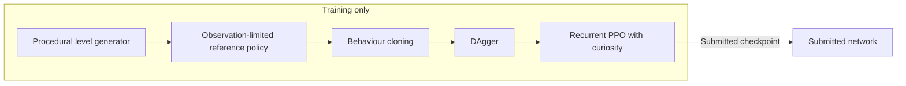

# Naksha

Naksha means “map” in Hindi. It is a neural network that plays DOOM levels it has never seen, finding keycards, opening the right doors and reaching the exit.

**The submitted policy reached the exit in 82% of runs (150 of 183) on a sealed holdout of 61 unseen maps, against 62% for the behaviour-cloned starting point and 2% for random play.**

**It exited 93% of arena, 89% of room, 80% of keycard and 64% of gauntlet runs, and the organiser’s `two_rooms` map in all 3 runs.**

**Single-threaded CPU inference took 3.3 ms at p50 and 3.7 ms at p99 in the official validator, against a 40 ms per-decision allowance.**

## Results on unseen maps

Results are for the submitted weights, the PPO checkpoint. `bc0` is the behaviour-cloned starting point. Brackets show Wilson 95% confidence intervals for exit rates. The reference policy is a comparison ceiling with access to true pose.

| Holdout family | Submitted exits [95% CI] | `bc0` exits | Random exits | Reference exits | Other outcomes per episode (submitted) |
| --- | ---: | ---: | ---: | ---: | --- |
| Rooms | 89% [77–95] | 73% | 0% | 96% | 2.87 doors opened |
| Keycards | 80% [66–89] | 62% | 0% | 100% | 1.80 keys picked up and 1.80 locked doors opened |
| Arenas | 93% [82–98] | 84% | 7% | 100% | 5.2 kills, no deaths |
| Gauntlets | 64% [50–77] | 27% | 0% | 71% | 16% deaths (reference 29%) |
| Organiser `two_rooms` | 3/3 | 3/3 | 0/3 | — | |
| **All** | **82% (150/183)** | 62% (114/183) | 2% (3/183) | 92% (165/180) | 4% deaths (`bc0` 8%) |

The sealed holdout contains 61 maps excluded from both training and checkpoint selection, with 60 generated maps from seeds 100000 and above (15 per family) and the organiser’s `two_rooms`, each run with 3 seeds.

## How it works



1. **Generate solvable levels.** The ASCII grid compiler emits UDMF WADs that follow the organiser’s test-map conventions. Maps it builds pass all 12 organiser wrapper cases used for compiler parity. The generator checks that the exit is reachable given the keys available along the way. It builds combat arenas, multi-room maps with doors, dead ends and loops, keycard chains with 1–3 locks and keys in side branches, and gauntlets.
2. **Label from observed evidence.** The reference policy uses its true pose to track cells revealed by its own rays. It plans over those cells, targets keys it has seen in its field of view, and targets the exit once it has line of sight. Each step gets an action and an intention label (explore, get key, go to door, go to exit, or fight).
3. **Clone the reference policy.** CPU collection produced 541,782 labelled steps across 1,600 maps in 4.8 minutes. Behaviour cloning took 25 minutes on an RTX 3050.
4. **Relabel student rollouts with DAgger.** The student drives on fresh maps each round, with reference actions mixed in according to the round’s schedule. The reference policy labels every step, including states reached after student mistakes. A candidate replaces the incumbent only if it scores higher on a separate development suite.
5. **Fine-tune with recurrent PPO.** The implementation shapes rewards around exits, keys, doors, kills, damage and death. It adds a count-based curiosity bonus for visiting new cells and uses a KL penalty to anchor the policy to the imitation checkpoint. The submitted checkpoint ran 4.8 M environment steps from a weight blend of two earlier PPO checkpoints, with half its maps given random textures, light and ceiling height and with mazes of 7–11 cells a side. We also tested a survival reward, a reward equal to the step-by-step change in the official map score, training on organiser-style layouts, a network with 4× the parameters and checkpoint ensembles. None beat the submitted checkpoint on held-out maps, so none is in it. Two training-only exploration rewards (`--progress-reward`, paid for walking toward the next key, its lock and then the exit; `--frontier-reward`, paid for walking toward the nearest unseen area until the exit is seen) clearly helped exploration on unseen maps after 35 minutes: on 24 sealed organiser-style maps, multi-room exits rose from 8 to 12–13 of 18, and with the frontier reward keycard-map exits rose from 14 to 18 of 18. But the agent rushed through fights, so deaths rose from 11 to 18–23 over 255 sealed runs and full-gauntlet exits fell from 8 to 3–4 of 18. The tier-weighted score fell, so neither is in the submitted checkpoint.

The organiser rules allow privileged state and planning as training scaffolding. [Ground rules](docs/RULES.md)

## The agent at evaluation

The 1.65 M-parameter network processes 64 egocentric rays with circular convolutions and pools visible entities with masked attention. It combines those features with vitals, the previous macro action and a CNN encoding of the downsampled 40×30 RGB view.

A GRU with 256 hidden units carries state between decisions and resets before each episode. The action head scores 14 macro actions. A fixed lookup maps the selected macro to the organiser’s button vector. The intention head supplies the demo readout.

The agent uses the official wrapper observations and its own recurrent state. Every action comes from the trained weights. The evaluation path excludes planners, aim-bots and privileged state. [Evaluation contract](docs/CONTRACT.md) · [Ground rules](docs/RULES.md)

Inference uses one CPU thread and no GPU memory. The weights occupy 6.6 MB. The organiser’s compute allowance is 40 ms times the decision cap for the map. [Evaluation timeouts](docs/EVALUATION.md#timeouts)

| CPU decision latency | p50 | p99 |
| --- | ---: | ---: |
| Local (`validate.py`) | 3.3 ms | 3.7 ms |
| CI validator (GitHub Actions) | 1.9 ms | 2.4 ms |

GitHub Actions fetches weights through Git LFS and runs the organiser wrapper tests, compiler parity, model, agent, rules-guard, shard, DAgger-loop, PPO and demo tests, then the official `validate.py`, on pushes to `main` and on pull requests. [CI workflow](.github/workflows/ci.yml)

## Spatial memory

Spatial memory v2 uses learned odometry to estimate forward and sideways motion and heading change from consecutive ray observations, velocity and the previous action. It integrates those estimates in an episode-local frame and writes its rays and visible entities into a grid. A CNN reads two ego-centred crops at different scales and feeds their features to the policy.

| Held-out odometry and memory measurements | Result |
| --- | ---: |
| Forward error per step | 0.25 map units |
| Sideways error per step | 0.23 map units |
| Turn error per step | 0.13° |
| Drift after 200 steps | 81 map units |
| Velocity-based dead-reckoning drift after 200 steps | 343 map units |
| Spatial memory time per step | 0.2 ms |

Spatial memory v2 is not in the submitted checkpoint, which uses the plain GRU. Its exit-rate ablation is pending.

## Reproduce

Run from the repository root with `uv` and Git LFS installed. The training commands use CUDA.

```bash
uv sync --group train
git lfs pull --include="submission/weights/naksha.pt"
```

### Generate the dev and holdout suites

The presets recreate the original suite manifests. Collection below generates and compiles its own training maps.

```bash
uv run --no-sync python -m training.eval.make_suite --preset dev --out data/suites/dev.json
uv run --no-sync python -m training.eval.make_suite --preset holdout \
  --check 346227e923dfe48a88a4cc559f34d8a34a178b76154f1423f370ed3f6a7900c9 \
  --out data/suites/holdout.json
```

### Collect, train and run DAgger

```bash
uv run --no-sync python -m training.data.collect --out data/bc0 --seeds 0 1600
uv run --no-sync python -m training.bc.train \
  --data data/bc0 --out runs/ckpt/bc0.pt --minutes 25
uv run --no-sync python -m training.dagger.loop \
  --init runs/ckpt/bc0.pt --data-dirs data/bc0 --work runs/dagger
```

### Evaluate the holdout

Use the Git LFS checkpoint to evaluate the submitted weights. The reference policy runs on generated maps where a grid is available. The evaluator writes episode results to `runs/eval/`.

```bash
uv run --no-sync python -m training.eval.run --suite data/suites/holdout.json \
  --policy agent --weights submission/weights/naksha.pt --seeds 3 --procs 3 --name holdout-final
uv run --no-sync python -m training.eval.run --suite data/suites/holdout.json \
  --policy random --seeds 3 --procs 3 --name holdout-random
uv run --no-sync python -m training.eval.run --suite data/suites/holdout.json \
  --policy teacher --seeds 3 --procs 3 --name holdout-teacher
uv run --no-sync python -m training.eval.report \
  --runs final=runs/eval/holdout-final.json random=runs/eval/holdout-random.json \
    reference=runs/eval/holdout-teacher.json \
  --families rooms locks arena gauntlet organiser --format md
```

### Demo

```bash
uv run --no-sync python -m demo.server --port 8765 --weights submission/weights/naksha.pt --maps data/suites/dev.json
```

Open `http://127.0.0.1:8765`. Type an ASCII map or pick an example, then watch the agent play live with its predicted intention, keys and events. [ASCII map legend](training/gen/compile.py)

`demo/record.py` records episodes. [Recorder](demo/record.py)

## Limits

- The holdout uses unseen seeds from the same generator families and one organiser test map. Hidden evaluation maps may have different layouts and encounters.
- Gauntlets are the weakest family (64% exits, 16% deaths).
- Most remaining failures are timeouts, not deaths: on door-heavy layouts with several rooms, and on large mazes, the policy can keep exploring rooms it has seen and run out of time before the exit. The exploration rewards above fix much of this in training, but at a cost in fighting that we could not remove in time.
- The local scores are proxies for official performance because the official weights are private.

## Repository layout

| Path | Contents |
| --- | --- |
| [`submission/`](submission/) | Evaluation entry point, observation encoding, action table, networks and Git LFS weights |
| [`training/gen/`](training/gen/) | Procedural map families, solvability checks and the grid-to-WAD compiler |
| [`training/teacher/`](training/teacher/) and [`training/data/`](training/data/) | Reference policy, rollout collection and episode shards |
| [`training/bc/`](training/bc/), [`training/dagger/`](training/dagger/), [`training/ppo/`](training/ppo/), [`training/memory/`](training/memory/) | Imitation learning, checkpoint selection, reinforcement learning and memory training |
| [`training/eval/`](training/eval/) | Suite generation and local evaluation |
| [`demo/`](demo/) | Live browser demo and episode recorder |
| [`env/`](env/), [`tests/`](tests/), [`validate.py`](validate.py) | Organiser wrapper, test suite and official validator |
| [`docs/`](docs/) | Organiser contract, rules and evaluation specification |
