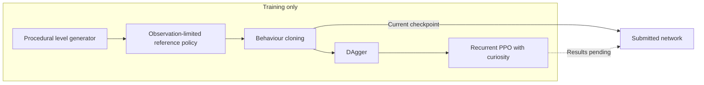

# Naksha

Naksha means “map” in Hindi. It is a neural network that plays DOOM levels it has never seen, finding keycards, opening the right doors and reaching the exit.

**The behaviour-cloned policy reached the exit in 84% of arena runs, 73% of room runs and 62% of keycard runs on the holdout.**

**It exited the organiser’s `two_rooms` map in all 3 runs.**

**Single-threaded CPU inference took 2.3 ms at p50 and 5.9 ms at p99 locally, against a 40 ms per-decision allowance.**

## Results on unseen maps

Results are for `bc0`, trained by behaviour cloning. Brackets show Wilson 95% confidence intervals for exit rates. The reference policy is a comparison ceiling with access to true pose.

<!-- update at freeze -->
| Holdout family | `bc0` exits [95% CI] | Random exits | Reference exits | Other outcomes per episode |
| --- | ---: | ---: | ---: | --- |
| Rooms | 73% [59–84] | 0% | 96% | 2.24 doors opened |
| Keycards | 62% [48–75] | 0% | 100% | 1.51 keys picked up and 1.42 locked doors opened (random 0.53 and 0.20) |
| Arenas | 84% [71–92] | 7% | 100% | 5.3 kills |
| Gauntlets | 27% [16–41] | 0% | 71% | |
| Organiser `two_rooms` | 3/3 | 0/3 | — | |

The sealed holdout contains 61 maps excluded from both training and checkpoint selection, with 60 generated maps from seeds 100000 and above (15 per family) and the organiser’s `two_rooms`, each run with 3 seeds.

## How it works



1. **Generate solvable levels.** The ASCII grid compiler emits UDMF WADs that follow the organiser’s test-map conventions. Maps it builds pass all 12 organiser wrapper cases used for compiler parity. The generator checks that the exit is reachable given the keys available along the way. It builds combat arenas, multi-room maps with doors, dead ends and loops, keycard chains with 1–3 locks and keys in side branches, and gauntlets.
2. **Label from observed evidence.** The reference policy uses its true pose to track cells revealed by its own rays. It plans over those cells, targets keys it has seen in its field of view, and targets the exit once it has line of sight. Each step gets an action and an intention label (explore, get key, go to door, go to exit, or fight).
3. **Clone the reference policy.** CPU collection produced 541,782 labelled steps across 1,600 maps in 4.8 minutes. Behaviour cloning took 25 minutes on an RTX 3050.
4. **Relabel student rollouts with DAgger.** The student drives on fresh maps each round, with reference actions mixed in according to the round’s schedule. The reference policy labels every step, including states reached after student mistakes. A candidate replaces the incumbent only if it scores higher on a separate development suite.
5. **Fine-tune with recurrent PPO.** The implementation shapes rewards around exits, keys, doors, kills, damage and death. It adds a count-based curiosity bonus for visiting new cells and uses a KL penalty to anchor the policy to the imitation checkpoint. Results are pending.

The organiser rules allow privileged state and planning as training scaffolding. [Ground rules](docs/RULES.md)

## The agent at evaluation

The 1.65 M-parameter network processes 64 egocentric rays with circular convolutions and pools visible entities with masked attention. It combines those features with vitals, the previous macro action and a CNN encoding of the downsampled 40×30 RGB view.

A GRU with 256 hidden units carries state between decisions and resets before each episode. The action head scores 14 macro actions. A fixed lookup maps the selected macro to the organiser’s button vector. The intention head supplies the demo readout.

The agent uses the official wrapper observations and its own recurrent state. Every action comes from the trained weights. The evaluation path excludes planners, aim-bots and privileged state. [Evaluation contract](docs/CONTRACT.md) · [Ground rules](docs/RULES.md)

Inference uses one CPU thread and no GPU memory. The weights occupy 6.6 MB. The organiser’s compute allowance is 40 ms times the decision cap for the map. [Evaluation timeouts](docs/EVALUATION.md#timeouts)

<!-- update at freeze -->
| CPU decision latency | p50 | p99 |
| --- | ---: | ---: |
| Local | 2.3 ms | 5.9 ms |
| CI validator | 1.0 ms | 1.6 ms |

GitHub Actions fetches weights through Git LFS and runs the organiser wrapper tests, compiler parity, model, agent, rules-guard, shard, DAgger-loop, PPO and demo tests, then the official `validate.py`, on pushes to `main` and on pull requests. [CI workflow](.github/workflows/ci.yml)

## Spatial memory

Spatial memory v2 uses learned odometry to estimate forward and sideways motion and heading change from consecutive ray observations, velocity and the previous action. It integrates those estimates in an episode-local frame and writes its rays and visible entities into a grid. A CNN reads two ego-centred crops at different scales and feeds their features to the policy.

<!-- update at freeze -->
| Held-out odometry and memory measurements | Result |
| --- | ---: |
| Forward error per step | 0.25 map units |
| Sideways error per step | 0.23 map units |
| Turn error per step | 0.13° |
| Drift after 200 steps | 81 map units |
| Velocity-based dead-reckoning drift after 200 steps | 343 map units |
| Spatial memory time per step | 0.2 ms |

The exit-rate ablation against the plain GRU is pending. The `bc0` results above use the plain GRU.

## Reproduce

Run from the repository root with `uv` and Git LFS installed. The training commands use CUDA.

```bash
uv sync --group train
git lfs pull --include="submission/weights/naksha.pt"
```

### Generate the dev and holdout suites

The suite manifests are local run files. This rebuilds them from the original seed ranges and adds the organiser WAD to the holdout. Collection below generates and compiles its own training maps.

```bash
(
  set -euo pipefail
  suite_parts=$(mktemp -d)
  trap 'rm -r -- "$suite_parts"' EXIT

  families=(arena rooms locks gauntlet)
  sizes=(s m l)
  for family in "${!families[@]}"; do
    for size in "${!sizes[@]}"; do
      dev_start=$((50000 + 1000 * family + 100 * size))
      holdout_start=$((100000 + 1000 * family + 100 * size))
      uv run --no-sync python -m training.eval.make_suite \
        --families "${families[family]}" --sizes "${sizes[size]}" \
        --seeds "$dev_start-$((dev_start + 2))" \
        --out "$suite_parts/dev-$family-$size.json"
      uv run --no-sync python -m training.eval.make_suite \
        --families "${families[family]}" --sizes "${sizes[size]}" \
        --seeds "$holdout_start-$((holdout_start + 4))" \
        --out "$suite_parts/holdout-$family-$size.json"
    done
  done

  uv run --no-sync python - "$suite_parts" <<'PY'
import json
import sys
from pathlib import Path

parts = Path(sys.argv[1])
output = Path("data/suites")
output.mkdir(parents=True, exist_ok=True)
for suite in ("dev", "holdout"):
    specs = []
    for path in sorted(parts.glob(f"{suite}-*.json")):
        specs.extend(json.loads(path.read_text()))
    if suite == "holdout":
        specs.append({
            "id": "organiser-two_rooms", "family": "organiser", "seed": 0,
            "size": "s", "wad": "maps/two_rooms.wad", "episode_ticks": 2100,
            "grid": None, "locks": [],
        })
    (output / f"{suite}.json").write_text(json.dumps(specs, indent=2) + "\n")
PY
)
```

### Collect, train and run DAgger

```bash
uv run --no-sync python -m training.data.collect --out data/bc0 --seeds 0 1600
uv run --no-sync python -m training.bc.train \
  --data data/bc0 --out runs/ckpt/bc0.pt --minutes 25
uv run --no-sync python -m training.dagger.loop \
  --init runs/ckpt/bc0.pt --data-dirs data/bc0 --work runs/dagger
```

### Evaluate the holdout

Use the Git LFS checkpoint to evaluate the reported `bc0` weights. The reference policy runs on generated maps where a grid is available. The evaluator writes episode results to `runs/eval/`.

```bash
uv run --no-sync python -m training.eval.run --suite data/suites/holdout.json \
  --policy agent --weights submission/weights/naksha.pt --seeds 3 --name holdout-bc0
uv run --no-sync python -m training.eval.run --suite data/suites/holdout.json \
  --policy random --seeds 3 --name holdout-random
uv run --no-sync python -m training.eval.run --suite data/suites/holdout.json \
  --policy teacher --seeds 3 --name holdout-teacher
```

### Demo

```bash
uv run --no-sync python -m demo.server --port 8765 --weights submission/weights/naksha.pt --maps data/suites/dev.json
```

Open `http://127.0.0.1:8765`. Type an ASCII map or pick an example, then watch the agent play live with its predicted intention, keys and events. [ASCII map legend](training/gen/compile.py)

`demo/record.py` records episodes. [Recorder](demo/record.py)

## Limits

- The holdout uses unseen seeds from the same generator families and one organiser test map. Hidden evaluation maps may have different layouts and encounters.
- Combat on gauntlets is the weakest area. In one recorded failure, the policy waited at a locked door while the key was beside the spawn. DAgger targets recovery from errors like this.
- The local scores are proxies for official performance because the official weights are private.

## Repository layout

| Path | Contents |
| --- | --- |
| [`submission/`](submission/) | Evaluation entry point, observation encoding, action table, networks and Git LFS weights |
| [`training/gen/`](training/gen/) | Procedural map families, solvability checks and the grid-to-WAD compiler |
| [`training/teacher/`](training/teacher/) and [`training/data/`](training/data/) | Reference policy, rollout collection and episode shards |
| [`training/bc/`](training/bc/), [`training/dagger/`](training/dagger/), [`training/ppo/`](training/ppo/), [`training/memory/`](training/memory/) | Imitation learning, checkpoint selection, reinforcement learning and memory training |
| [`training/eval/`](training/eval/) | Suite generation and local evaluation |
| [`demo/`](demo/) | Live browser demo and episode recorder |
| [`env/`](env/), [`tests/`](tests/), [`validate.py`](validate.py) | Organiser wrapper, test suite and official validator |
| [`docs/`](docs/) | Organiser contract, rules and evaluation specification |
